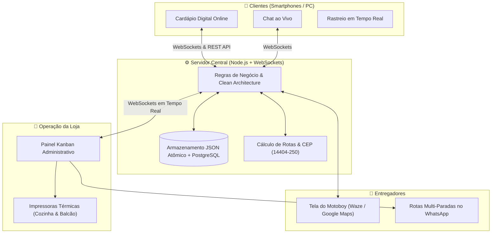

# 📘 Explosão Açaí — Manual e Documentação Completa do Sistema

> **Visão Geral:** O **Explosão Açaí** é um ecossistema completo de delivery e gestão de pedidos desenvolvido sob medida para alta performance, controle operacional em tempo real e facilidade de uso tanto para os clientes quanto para a equipe da loja e entregadores.

---

## 📑 Sumário

1. [Arquitetura Geral da Plataforma](#1-arquitetura-geral-da-plataforma)
2. [Módulo 1: Cardápio Digital do Cliente (`/`)](#2-módulo-1-cardápio-digital-do-cliente-)
3. [Módulo 2: Painel Administrativo e Kanban (`/admin`)](#3-módulo-2-painel-administrativo-e-kanban-admin)
4. [Módulo 3: Central de Rotas & Painel do Entregador (`/motoboy.html`)](#4-módulo-3-central-de-rotas--painel-do-entregador-motoboyhtml)
5. [Módulo 4: Central de Chat em Tempo Real](#5-módulo-4-central-de-chat-em-tempo-real)
6. [Módulo 5: Regras Comerciais, Frete e Pagamentos](#6-módulo-5-regras-comerciais-frete-e-pagamentos)
7. [Módulo 6: Automações, Impressão Térmica e Relatórios](#7-módulo-6-automações-impressão-térmica-e-relatórios)
8. [Estrutura Técnica, Testes e Deploy](#8-estrutura-técnica-testes-e-deploy)

---

## 1. Arquitetura Geral da Plataforma

O sistema é dividido em três grandes interfaces sincronizadas instantaneamente via **WebSockets bidirecionais**:



---

## 2. Módulo 1: Cardápio Digital do Cliente (`/`)

A interface pública de atendimento acessada pelo cliente oferece uma experiência fluida, sem necessidade de baixar aplicativo:

### 🍨 Personalização Completa de Produtos
- **Seleção de Copos e Tamanhos:** visualização de fotos em alta resolução, descrição e valores base.
- **Acompanhamentos Gratuitos:** controle rígido de quantidade máxima permitida (ex: escolha até 3 itens grátis).
- **Acompanhamentos Pagos / Adicionais:** adição ilimitada de itens extras com acréscimo automático no valor final.
- **Frutas, Caldas e Coberturas:** personalização organizada por abas claras.
- **Observações Especiais:** campo aberto para o cliente indicar preferências (ex: *"colocar leite em pó no fundo e no topo"*).

### 📍 Localização e Frete Inteligente em Duas Vias
- **Origem Fixa:** calculado sempre a partir da loja: **CEP 14404-250** (*Rua Renato Lourenço Fernandes Rosa, 1721 · Aeroporto 3, Franca/SP*).
- **Preenchimento Bidirecional:**
  - Digitando o **CEP (8 dígitos)**: o sistema preenche automaticamente Rua e Bairro via ViaCEP e recalcula a taxa na hora.
  - Digitando a **Rua (a partir de 3 letras)**: o sistema pesquisa na base oficial de Franca/SP, preenche o CEP e Bairro automaticamente em tempo real.
- **Política de Frete:**
  - Até **2 km** da loja ➔ **Grátis (R$ 0,00)**.
  - Acima de **2 km** ➔ Trajeto real por vias públicas calculado com base na tabela da loja (mínimo de R$ 4,50 ou R$ 1,00/km configurável).

### 🏷️ Sistema de Cupons de Desconto
- Cupons com desconto em **reais (R$)** ou em **porcentagem (%)**.
- Validação automática de valor mínimo do pedido, limite de usos e teto máximo de desconto.

### 💳 Opções de Pagamento no Checkout
1. **Pix Instantâneo:** gera o código oficial **Pix Copia e Cola EMVCo** e o **QR Code escaneável** diretamente na tela.
2. **Cartão na Entrega / Balcão:** seleção de Crédito ou Débito para envio de maquininha.
3. **Dinheiro:** campo inteligente de troco que calcula e registra exatamente quanto o entregador deve levar de troco.

### 📦 Acompanhamento em Tempo Real
- Após finalizar o pedido, a tela se transforma em uma linha do tempo atualizada automaticamente via WebSockets:
  - `Aguardando Confirmação` ➔ `Em Preparo` ➔ `Pronto / Saiu para Entrega` ➔ `Entregue`.
- Botão direto para abrir o **Chat ao Vivo** com a loja.

---

## 3. Módulo 2: Painel Administrativo e Kanban (`/admin`)

O coração operacional da loja, protegido por senha (`RafaeLL@2`), projetado para alta agilidade no atendimento:

```
┌─────────────────────────────────────────────────────────────────────────────────────────────┐
│ 📥 Novos   │ 🍧 Em Preparo │ 🛵 Saiu/Pronto │ 📦 Entregues Hoje │ 🗄️ Pedidos Concluídos     │
│ (Aguardando│ (Na cozinha/  │ (Em rota ou no │ (Entregues no dia │ (Histórico permanente     │
│  produção) │  montagem)    │  balcão)       │  atual)           │  arquivado)               │
└─────────────────────────────────────────────────────────────────────────────────────────────┘
```

### 📋 Gestão de Pedidos em Colunas (Kanban)
1. **Novos Pedidos:** pedidos recém-chegados com aviso sonoro alto e botão para aceitar e avançar para preparo.
2. **Em Preparo:** pedidos atualmente na bancada de montagem.
3. **Pronto para Entrega / Retirada:** pedidos embalados prontos para saída de motoboy ou balcão.
4. **Entregues Hoje:** histórico de todos os pedidos finalizados no dia de hoje com valores faturados.
5. **Pedidos Concluídos (Histórico Permanente):** arquivamento seguro automático que preserva o histórico de dias anteriores.
6. **Devolvidos à Loja:** registro de pedidos com insucesso de entrega (cliente ausente, etc.) com motivo justificado.
7. **Cancelados:** pedidos cancelados com estorno de itens e justificativa registrada.

### 💬 Notificações de WhatsApp em 1 Clique
- Botões diretos no card do pedido para enviar avisos padronizados com o primeiro nome do cliente:
  - *Pedido Confirmado e em Preparo*;
  - *Pedido Saiu para Entrega* (inclui chave Pix se o motoboy for cobrar no destino);
  - *Pedido Pronto para Retirada no Balcão*.
- Todos os números são formatados automaticamente com o código DDI `55` + DDD da cidade.

### 🏪 Controle da Loja & Horários
- **Chave Liga/Desliga Manual:** abre e fecha a loja imediatamente no cardápio com 1 clique.
- **Agendamento Semanal Automático:** define horário de abertura e fechamento para cada dia da semana.
- **Banner Promocional:** mensagem customizada exibida no topo do cardápio do cliente.

---

## 4. Módulo 3: Central de Rotas & Painel do Entregador (`/motoboy.html`)

Solução completa para despacho eficiente de entregadores e roteirização:

### 🗺️ Roteirizador Multi-Paradas (No Painel Admin)
- **Visualização no Mapa:** todos os pedidos prontos para entrega são plotados no mapa com seus endereços e dados.
- **Divisão Balanceada entre Motoboys:**
  - Botão seletor `[ 2, 3, 4, 5, 6 Motoboys ]` ➔ clica em **Gerar Divisão** e o sistema fatia os pedidos igualmente entre as rotas disponíveis (`Rota 1`, `Rota 2`, etc.).
  - Opção de **Seleção Manual** via caixas de seleção em cada parada.
- **Disparo da Rota para o WhatsApp do Motoboy:**
  - Gera uma mensagem estruturada com a sequência de paradas, nome do cliente, endereço completo, pontos de referência, valor a receber e troco.
  - Link multi-paradas do **Google Maps** pronto para o motoboy iniciar o GPS de todas as entregas na sequência ideal.
- **Atualização em Massa:** botão `🛵 Marcar em Rota` que move todos os pedidos selecionados para "Saiu para Entrega" simultaneamente.

### 📱 Tela Exclusiva do Motoboy (`public/motoboy.html`)
- Interface leve e de alto contraste otimizada para uso em suporte de moto com luz solar:
  - Botão **Waze** com 1 clique para navegar até o endereço.
  - Botão **Google Maps** com 1 clique.
  - Botão **Copiar Endereço Completo** para colar em outros aplicativos.
  - **Destaque Amarelo de Referência:** chama a atenção para instruções do cliente (*"casa verde portão preto sem campainha"*).
  - Informações claras de cobrança: valor a receber, necessidade de troco ou indicação de "Já Pago via Pix".
  - Botão para o próprio entregador confirmar a entrega e o recebimento, atualizando a loja em tempo real.

---

## 5. Módulo 4: Central de Chat em Tempo Real

Atendimento humanizado e instantâneo integrado dentro da própria aplicação:

- **Isolamento Estrito:** cada cliente possui sua sala privada e criptografada em sessão; nenhum cliente tem acesso a conversas de terceiros.
- **Identificação do Pedido Ativo:** ao abrir a conversa com um cliente no painel da loja, o topo exibe o número do pedido em andamento, itens e endereço.
- **Respostas Rápidas em 1 Clique:**
  - `🍧 Em Preparo` ➔ *"Seu açaí já está sendo preparado com muito capricho!"*
  - `🛵 Saiu p/ Entrega` ➔ *"Seu pedido acabou de sair com nosso entregador!"*
  - `🏪 Pronto no Balcão` ➔ *"Seu pedido está pronto para retirada no balcão!"*
  - `⭐ Agradecimento` ➔ *"Agradecemos a preferência! Bom apetite!"*
- **Avisos Sonoros e Visuais:** som discreto de notificação a cada nova mensagem e piscar dinâmico no título da aba do navegador (`💬 Nova mensagem de [Cliente]!`).

---

## 6. Módulo 5: Regras Comerciais, Frete e Pagamentos

### 💰 Regra de Impressão Rígida e Proteção Contra Golpes
Para proteger a loja contra prejuízos decorrentes de comprovantes Pix falsos:
- Pedidos pagos via **Pix**: a comanda **não imprime** e o pedido não avança até que a loja valide o recebimento real e confirme o status para **Pago** no painel.
- Pedidos com **Cartão na Entrega** ou **Dinheiro**: liberam a impressão imediata na cozinha, pois a cobrança ocorre fisicamente pelo motoboy.

### 📐 Calibração Geográfica de Franca/SP (Saída: CEP 14404-250)
O motor de frete (`src/application/services/FreightService.js`) combina:
1. Reconhecimento instantâneo do endereço da loja (0,5 km ➔ Grátis);
2. Roteamento por malha viária oficial via Photon e OSRM;
3. Tabela calibrada de distâncias reais a partir do Jd. Aeroporto 3:
   - *Aeroporto 1, 2, 3, 4, Mundo Novo, Universitário:* **1,5 km (Grátis)**
   - *Jd. Santa Cruz:* **3,5 km**
   - *Jd. Elimar / Santa Lúcia:* **4,5 km**
   - *Parque Progresso:* **5,0 km**
   - *Jd. Paulistano:* **6,0 km**
   - *Centro / Estação:* **8,0 a 8,5 km**
   - *Cidade Nova:* **9,8 km**
   - *Leporace / Miramontes / Vera Cruz:* **14,2 a 15,5 km**

---

## 7. Módulo 6: Automações, Impressão Térmica e Relatórios

### 🖨️ Módulo de Impressão Térmica
- Separação inteligente de comandas:
  - **Comanda da Cozinha:** foco nos itens, tamanhos, acompanhamentos selecionados e observações da receita.
  - **Comanda do Balcão / Entrega:** foco nos dados de entrega, telefone do cliente, valores a receber e troco.
- Suporte para impressoras térmicas padrão de **58 mm** e **80 mm** com quebra de linha automática.

### 🌙 Automação da Virada do Dia (Horário de Brasília)
- Todo dia, pontualmente às **03:00 da manhã (horário oficial de Brasília)**:
  - Os pedidos da coluna `Entregues Hoje` são arquivados com segurança para o histórico permanente.
  - A coluna do dia atual amanhece limpa e pronta para o novo expediente, sem perder nenhum dado financeiro.

### 📊 Relatórios Financeiros e DRE Operacional
- No painel administrativo (`/admin`), a aba de Relatórios consolida:
  - **Faturamento Bruto:** valor total de vendas;
  - **Ticket Médio:** valor médio por pedido;
  - **Descontos Aplicados:** impacto total de cupons de desconto;
  - **Taxas de Entrega Arrecadadas:** controle para repasse de motoboys;
  - **Divisão por Forma de Pagamento:** % e valores em Pix, Cartão de Crédito, Cartão de Débito e Dinheiro;
  - **Ficha Técnica & Alerta de Custo:** aponta a margem de lucro de cada produto e emite alerta visual se o preço de venda estiver próximo ao custo dos insumos.

---

## 8. Estrutura Técnica, Testes e Deploy

### 🧱 Estrutura de Código (Clean Architecture)
```
Delivery Acai/
├── data/
│   └── database.json            # Base atômica estruturada com persistência local
├── public/                      # Frontends HTML/CSS/JS puros e ultrarrápidos
│   ├── index.html               # Cardápio do Cliente
│   ├── admin.html               # Painel Administrativo / Kanban
│   ├── motoboy.html             # Painel Mobile do Entregador
│   ├── css/                     # Estilos visuais e temas responsivos
│   └── js/                      # Lógicas de tela, WebSockets e APIs
├── src/
│   ├── application/services/    # Regras de Negócio (Catalog, Order, Freight, Chat, Report)
│   ├── domain/entities/         # Entidades puras (Order, Product, Coupon)
│   ├── infrastructure/          # Banco de dados, WebSockets, Impressão, Notificações
│   ├── presentation/            # Controladores REST, Middlewares de Autenticação e Rotas
│   └── server.js                # Inicialização do servidor Node.js
└── tests/                       # 34 testes automatizados em node:test
```

### 🧪 Suíte de Testes Automatizados
O projeto conta com **34 testes automatizados** cobrindo 100% dos fluxos críticos:
- Cálculo exato de frete e isenção até 2 km;
- Geração válida de Pix EMVCo e QR Code escaneável;
- Bloqueio rígido de impressão térmica para pedidos não confirmados;
- Troco em dinheiro e validações de cupons;
- Isolamento absoluto de mensagens no chat em tempo real;
- Rota de entrega e confirmação de recebimento do motoboy;
- Automação da virada de dia e arquivamento permanente.

Execução:
```bash
npm test
# Result: 34 pass, 0 fail (100% aprovado)
```

### 🚀 Deploy Contínuo no Render
- O repositório está conectado ao serviço no Render.
- Todo `git push origin master` e `origin master:main` compila os testes e atualiza o servidor em produção de forma 100% automatizada e sem interrupções.

---
*Documentação gerada e validada para a versão de produção do Explosão Açaí.*
